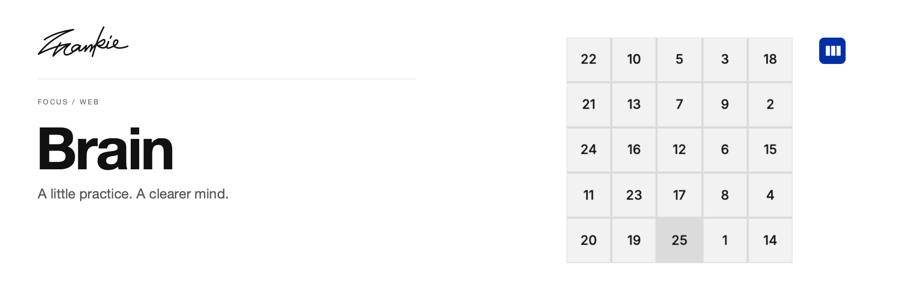

# Frankie Brain

Short Schulte-grid and arithmetic sessions for practicing attention, speed and accuracy.

**Web** · [iOS version](https://github.com/SonghaiFan/frankie-brain-ios) · [Guide](docs/guide.md) · [Run locally](#run-locally)

## What it does

- Practice attention with configurable Schulte grids, symbols and ordering.
- Work through timed Quick Math sessions.
- Review local history, result charts and Schulte replays.

## Run locally

```sh
npm ci
npm run dev
```

Open the local URL printed by Vite. Training does not require a model API key.

## Before you start

History stays in this browser and on this origin. It does not automatically transfer to another address or to the iOS version.

## For developers

```sh
npm run lint
npm run build
```

[Project guide](docs/guide.md) · [Artwork](docs/readme/README.md)

---

Made by [Songhai Fan](https://github.com/SonghaiFan) · A Frankie project
