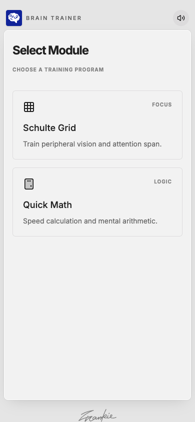

<h1 align="center"><picture><source media="(prefers-color-scheme: dark)" srcset=".github/brand/icon-dark.svg"></picture><br>Frankie Brain</h1>

<p align="center"><b>用舒尔特方格与快速算术练习，训练注意力、速度和准确度。</b></p>

<p align="center"><a href="https://songhaifan.github.io/frankie-brain/zh/">项目介绍</a> · <a href="https://brain-training-game.vercel.app">打开应用</a> · <a href="docs/guide.md">使用指南</a> · <a href="README.md">English</a></p>

<p align="center"></p>

## 可以做什么

- 自定义舒尔特方格的大小、符号与顺序，练习注意力。
- 完成限时 Quick Math 算术练习。
- 查看本地历史、成绩图表与舒尔特回放。

## 本地运行

```sh
npm ci
npm run dev
```

打开 Vite 输出的本地地址。训练不需要模型 API key。

## 开始之前

历史记录保存在当前浏览器和当前站点，不会自动同步到其他地址或 iOS 版。

## 开发说明

```sh
npm run lint
npm run build
```

[项目指南](docs/guide.md) · [Banner 维护](docs/readme/README.md)

---

<p align="center"><a href="https://songhaifan.github.io/frankie-brain/"></a> &nbsp; <a href="https://songhaifan.github.io/frankie-brain-ios/"></a> &nbsp; <a href="https://songhaifan.github.io/frankie-cards/"></a> &nbsp; <a href="https://songhaifan.github.io/frankie-dictionary/"></a> &nbsp; <a href="https://songhaifan.github.io/frankie-generative-art/"></a> &nbsp; <a href="https://songhaifan.github.io/frankie-goal/"></a> &nbsp; <a href="https://songhaifan.github.io/frankie-guitar/"></a> &nbsp; <a href="https://songhaifan.github.io/frankie-list/"></a> &nbsp; <a href="https://songhaifan.github.io/frankie-mbti/"></a> &nbsp; <a href="https://songhaifan.github.io/frankie-onitama/"></a> &nbsp; <a href="https://songhaifan.github.io/frankie-poker/"></a> &nbsp; <a href="https://songhaifan.github.io/frankie-stocks/"></a> &nbsp; <a href="https://songhaifan.github.io/frankie-tarot/"></a> &nbsp; <a href="https://songhaifan.github.io/frankie-tarot-api/"></a> &nbsp; <a href="https://songhaifan.github.io/frankie-werewolf/"></a></p>

<p align="center"><sub>Frankie 系列 · 制作：<a href="https://github.com/SonghaiFan">Songhai Fan</a></sub></p>

<p align="right"><picture><source media="(prefers-color-scheme: dark)" srcset=".github/brand/signature-dark.svg"></picture></p>
