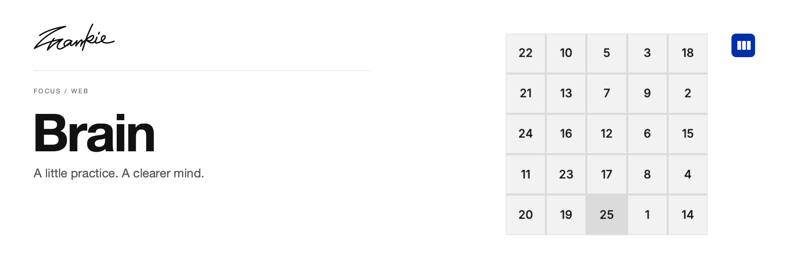

# Frankie Brain

[English](README.md) · [简体中文](README.zh-CN.md)

用舒尔特方格与快速算术练习，训练注意力、速度和准确度。

[介绍页](https://songhaifan.github.io/frankie-brain/zh/) · **Web** · [iOS 版](https://github.com/SonghaiFan/frankie-brain-ios) · [项目指南](docs/guide.md) · [本地运行](#本地运行)

## 可以做什么

- 自定义舒尔特方格的大小、符号与顺序，练习注意力。
- 完成限时 Quick Math 算术练习。
- 查看本地历史、成绩图表与舒尔特回放。

## 本地运行

```sh
npm ci
npm run dev
```

打开 Vite 输出的本地地址。训练不需要模型 API key。

## 开始之前

历史记录保存在当前浏览器和当前站点，不会自动同步到其他地址或 iOS 版。

## 开发说明

```sh
npm run lint
npm run build
```

[项目指南](docs/guide.md) · [Banner 维护](docs/readme/README.md)

---

由 [Songhai Fan](https://github.com/SonghaiFan) 制作 · Frankie 系列项目
